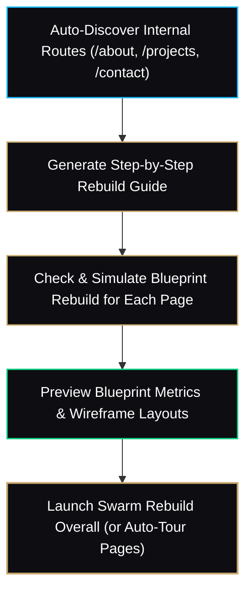

<div align="center">

  

  # ✦ SWARM REBUILD ✦

  <p><strong>A Multiplayer Cursor Orchestrator that live-reconstructs any modern webpage into existence.</strong></p>

  <p>
    <a href="https://joelbastonelopez.com"></a>
    
    
    
  </p>

  <p>
    <i>Wipes any webpage down to an obsidian canvas and choreographs an autonomous flock of design cursors to rebuild it element-by-element with bounding boxes, live measurements, typewriter typography, and procedural sound.</i>
  </p>

  ---
</div>

## 🌟 Overview

**Swarm Rebuild** is a specialized Google Chrome Extension (Manifest V3) that turns any live webpage into a cinematic build showcase. Built with high-speed reverse-engineering and optimized for high-end WebGL, 3D portfolios, and heavy animated sites, it creates a theater-grade visual simulation ideal for **screen recordings, launch videos, Twitter/X reels, Product Hunt, and agency showreels**.


---

## ✨ Signature Features

- 🎯 **Autonomous Tour Mode (Default):** Starts immediately on activation. Glides down smoothly at a curated 1× pace without requiring user mouse intervention.
- 📐 **Live Figma-Style Bounding Boxes:** Cursors drag out rectangular bounds displaying real-time dimensions (`w × h`), blue guide lines, and snapping rules.
- ✍️ **Typewriter Engine:** Headlines, subheadings, and paragraphs are typed out character-by-character with realistic cadence and blinking I-beam carets.
- 🔊 **Procedural Web Audio Synthesizer:** Real-time tactile clicks, pops, pen taps, and typing noises synthesized in-browser (zero bulky MP3 dependencies).
- 🛡️ **WebGL & 3D Site Isolation:**
  - Automatically isolates fullscreen background WebGL shaders (`grainient-canvas`) and WebM video reels (`banner_web.webm`).
  - Pre-renders elements with CSS scroll transitions (`.animate-on-scroll`, `data-aos`, Bento grids) so no content is discarded.
  - Automatically filters out inactive modals (`#quoteModal`, overlay backdrops) for a noise-free reconstruction.
- 💎 **Instant Live Restore:** Press <kbd>Esc</kbd> or click **Go Live** at any moment to fade cleanly back to the real interactive webpage.
- 🗺️ **Multi-Page Steps Guide (`swarm-steps-guide.js`):** Automatically discovers internal navigation links across multi-page websites or SPA routes, builds a sequential step checklist, and simulates/pre-rebuilds blueprints for each page (measuring DOM depth, typography, media, and agent allocations with live wireframe previews) before launching the overall Swarm Rebuild.

---

## 🏗️ Architecture & Engineering

```
┌─────────────────────────────────────────────────────────────┐
│                       CHROME BROWSER                        │
│                                                             │
│   [ background.js ]  ──(Injects)──►  [ swarm.js ]           │
│                                              │              │
│       ┌──────────────────────────────────────┴──────────┐   │
│       ▼                                                 ▼   │
│  [ DOM Blueprint Parser ]                       [ Shadow DOM Host ]
│  • Bounding client rects                        • Isolated CSS root
│  • Typography & fonts                           • Obsidian backdrop
│  • Bento Grid & cover media                     • SVG Cursors layer
│  • Instant 0,0 scroll sync                      • HUD floating dock
│                                                             │
│       ┌─────────────────────────────────────────────────┘   │
│       ▼                                                     │
│  [ Web Audio Synthesizer ]  ──► Oscillator clicks & taps     │
└─────────────────────────────────────────────────────────────┘
```

1. **DOM Blueprinting:** Evaluates live geometry, calculated typography, and hierarchical layers without destroying the original document.
2. **Shadow Root Sandbox:** Injects the entire rebuild canvas and HUD inside an isolated Shadow DOM (`<swarm-rebuild>`) to prevent styling bleed or CSS conflicts.
3. **Flocking Physics:** Multiple cursors follow a boids/spring interpolation algorithm with dynamic heading angles, cursor tool swaps (arrow, I-beam, crosshair, pen), and avatar name badges.
4. **Scroll Unification:** Temporarily overrides `scroll-behavior: auto !important` on the host document to ensure silky 60fps auto-scroll synchronization across Chromium engines.

---

## 🚀 Installation (Load Unpacked)

Install locally in under 30 seconds:

1. Clone or download this repository:
   ```bash
   git clone https://github.com/JoelBastoneLopez/swarm-rebuild.git
   ```
2. Open Google Chrome and navigate to:
   ```text
   chrome://extensions/
   ```
3. Enable **Developer mode** toggle in the top-right corner.
4. Click **Load unpacked** (top-left) and choose the extension folder.
5. *(Optional)* Click the extension puzzle icon 🧩 in Chrome and **Pin 📌** Swarm Rebuild.

---

## 🎮 How to Use

1. Navigate to your target website (e.g. [`joelbastonelopez.com`](https://joelbastonelopez.com)) or open the included `demo.html`.
2. Press the global shortcut:
   ```text
   Alt + Shift + S
   ```
   *(Or click the Swarm Rebuild icon in the toolbar)*
3. Watch the canvas wipe clean and the swarm construct your entire portfolio from top to bottom.

### ⌨️ Controls & Shortcuts

| Action | Control | Description |
| :--- | :---: | :--- |
| **Trigger / Toggle** | <kbd>Alt</kbd> + <kbd>Shift</kbd> + <kbd>S</kbd> | Starts or stops the extension |
| **Multi-Page Steps Guide** | <kbd>Alt</kbd> + <kbd>Shift</kbd> + <kbd>G</kbd> | Opens the multi-page pre-flight guide and blueprint analyzer |
| **Exit Instantly** | <kbd>Esc</kbd> | Closes the canvas and restores the original website |
| **Toggle Tour** | `Tour` button in HUD | Toggles auto-scroll mode on / off |
| **Speed Control** | `1×` / `2×` / `3×` | Cycles build velocity |
| **Mute / Unmute** | <kbd>M</kbd> or 🔊 icon | Toggles procedural sound effects |
| **Go Live** | `Go Live` button | Gracefully fades back to the live interactive page |

---

## 🗺️ Multi-Page Steps Guide (`swarm-steps-guide.js`)

When documenting or showcasing larger multi-page portfolios, blogs, and web applications, Swarm Rebuild includes a dedicated, non-intrusive companion script: **`swarm-steps-guide.js`**.



### What It Does:
1. **Intelligent Route Discovery:** Automatically scans internal navigation elements (`<nav>`, `<header>`, `<aside>`, router links) on the current domain and organizes them into a clean rebuild pipeline (`Target 01: Home`, `Step 02: Projects`, `Step 03: About`, etc.).
2. **Pre-Flight "Supposed Rebuild" Simulation:** For each discovered page, the engine fetches and pre-analyzes the DOM structure:
   - Evaluates node counts, typography blocks, media tags (canvases, videos, images), and interactive elements.
   - Computes an estimated swarm cursor count and rebuild duration.
   - Generates an interactive **Blueprint Wireframe** preview detailing how agents will be assigned before launching.
3. **Obsidian & Gold Steps HUD:** An isolated Shadow DOM modal with real-time progress meters, procedural sound synthesis, custom route input, and auto-tour sequence options.
4. **Autonomous Platform Rebuild & Navigation Orchestrator:** Sequentially navigates across pages via `background.js`, auto-injecting the swarm so entire multi-page platforms are reconstructed from scratch.
5. **Smart Persistent Shell Optimization (SPA / React Mode):** When sequentially rebuilding multiple pages, persistent layout components (headers, sidebars, navigation shells) are preserved after Step 1. The swarm avoids wiping or re-drawing persistent navigation from scratch on subsequent steps, focusing cursor workers exclusively on the newly changed dynamic content.
6. **Zero-Flicker Instant Blank Transitions:** When navigating between pages or switching sections, an instant dark obsidian curtain blankets the screen from the very first paint of navigation (`status: 'loading'`). All DOM scans, font loading, and blueprint captures complete entirely behind the blanks, ensuring the user only ever sees a clean blank slate before cursor agents begin reconstructing the page.

### How to Use the Steps Guide:
- **Shortcut:** Press <kbd>Alt</kbd> + <kbd>Shift</kbd> + <kbd>G</kbd> on any page.
- **Standalone:** Include `<script src="swarm-steps-guide.js"></script>` in any HTML file.
- **Console / DevTools:**
  ```javascript
  window.__swarmStepsGuide.open();
  await window.__swarmStepsGuide.runChecks();
  window.__swarmStepsGuide.launchOverall();
  ```

---

## 🎨 Customization

### Personalizing Agent Names & Palette
You can give the cursors your own team names, AI assistants, or 3D tool names. Inside `swarm.js` (around line 22):

```javascript
const NAMES = [
  "Joel", "Blender", "Three.js", "ZBrush", "Unreal", "CGI", "Design",
  "Shader", "Sculpt", "LookDev", "Render", "Keyframe", "Lighting"
];

const COLORS = [
  "#c9a96e", "#F4D9A0", "#1ABCFE", "#0ACF83", "#FF7262", "#FFC700",
  "#9747FF", "#E8467C", "#14AE5C", "#0D99FF", "#FF8A00", "#00B5CE"
];
```

---

## 💼 Credits & Acknowledgments

- **Customized, Patched & Maintained by:** [Joel Bastone Lopez](https://joelbastonelopez.com) — *3D Artist, Modeling, Sculpting, Animation & Real-Time 3D for the Web*.
  - Engineered WebGL & canvas shader isolation (`grainient.js` support).
  - Isolated background HTML5 video showreels (`banner_web.webm`) from canvas collisions.
  - Implemented automatic 1× cinematic Tour mode & instant frame-by-frame scroll synchronization.
  - Resolved `.animate-on-scroll` & Bento Grid layout flattening issues.
  - Filtered out inactive modals (`#quoteModal`) and phantom form layers.
- **Original Base Prototype:** Based on [Dhvanil Patel's](https://github.com/DhvanilPatel/swarm-cursors) open-source `swarm-cursors` experiment.
- **Concept Inspiration:** Inspired by [Joel Califa's](https://twitter.com/notdetails) viral interactive *Swarm* project.

---

## 📄 License

This project is open-source under the [MIT License](LICENSE).

<div align="center">
  <sub>Crafted with passion for 3D & Web Experiences • <a href="https://joelbastonelopez.com">joelbastonelopez.com</a></sub>
</div>
